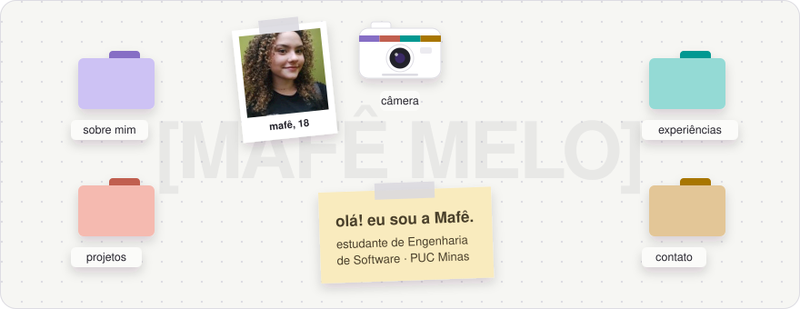
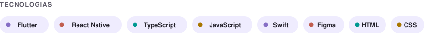

<h1 align="left">Olá, Me chamo Maria Fernanda Melo 👋💜</h1>

💡 Estudante de TI com foco em desenvolvimento mobile, apaixonada por tudo que envolve design e criatividade.✨

  
  &nbsp;
  
  &nbsp;
  

### Tecnologias

### Projetos

<table>
  <tr>
    <td width="50%" valign="top">
      <b><a href="https://github.com/davimurta/Aurora">Aurora</a></b> 
      Aplicativo mobile de saúde mental que conecta pacientes e psicólogos. 
      React Native · Expo · TypeScript
    </td>
    <td width="50%" valign="top">
      <b>Sintoniza</b> ★ melhor projeto da turma 2026.1 
      Plataforma web que conecta estabelecimentos e artistas musicais independentes. 
      JavaScript · HTML · CSS
    </td>
  </tr>
</table>

### Atividade

  

<picture>
  <source media="(prefers-color-scheme: dark)" srcset="https://raw.githubusercontent.com/mafemelo/mafemelo/output/github-contribution-grid-snake-dark.svg">
  <source media="(prefers-color-scheme: light)" srcset="https://raw.githubusercontent.com/mafemelo/mafemelo/output/github-contribution-grid-snake.svg">
  
</picture>
